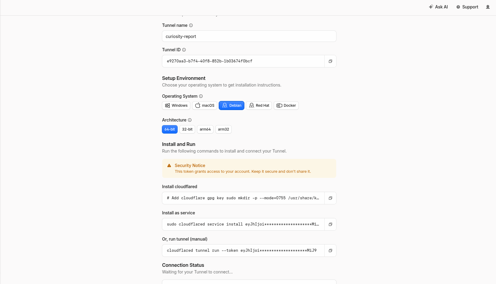
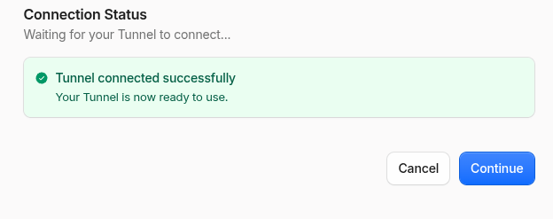
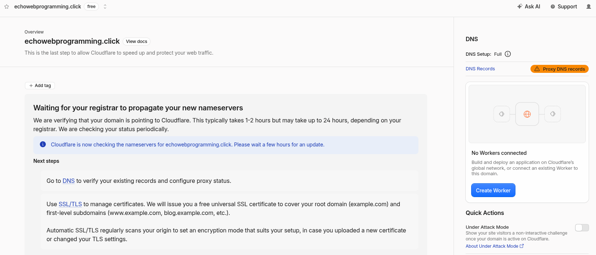
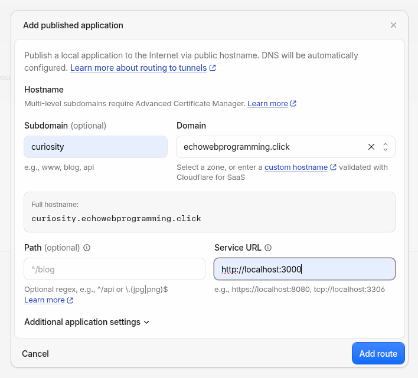
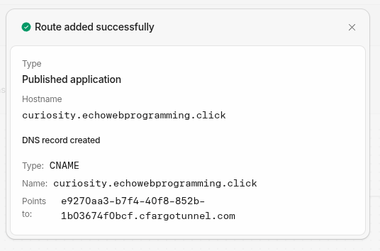
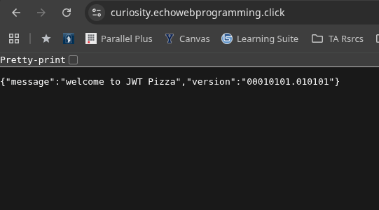

# Curiosity Report: Cloudflare Tunnels
I first heard of Cloudflare Tunnels months ago from a YouTube video. I had no idea what it was or how to use it, but I was hooked because I heard you can use it to safely expose a private IP address to the web. At the time, I was interested in hosting my own website from home for free in an apartment where I had no control over the router or network setup. Cloudflare Tunnels sounded like the solution to all my problems. However, I didn't look into it any further because I was busy with classes like CS 340, and it has just been sitting on the back shelf in my mind ever since.
## What is a Cloudflare Tunnel?
A Cloudflare Tunnel is a secure connection between a local server and Cloudflare's network that doesn't require exposing inbound ports or a public IP. It's super useful for hosting something from home because it allows you to connect your local server to the outside web without changing your network settings to allow inbound traffic. It also allows you to map a domain to your tunnel so your service or site can be accessible via a custom domain name instead of one chosen by Cloudflare. In addition to hosting web services, it can also be used for SSH and remote desktop connections, though there might be other services better suited for that.
## How does it relate to the course and state-of-the-art solutions?
As QA and DevOps engineers, we want simple, secure, reliable automated hosting solutions for services like the JWT Pizza service. Cloudflare Tunnels checks all the boxes for small-scale applications; a tunnel can be set up programmatically via the command line and connected to multiple instances of `cloudflared` for redundancy. In the course, a tunnel could fit with the backend: instead of exposing the JWT Pizza service through a public load balancer, the service could sit in a private subnet with no public IP while `cloudflared` runs alongside it and connects out to Cloudflare. That would close every inbound port while still letting AWS handle scaling.
## How does it work?
A daemon called `cloudflared` runs on your server and establishes a series of redundant connections from your server to the Cloudflare infrastructure. When outside traffic comes to your domain name, Cloudflare's servers catch it and forward the requests to `cloudflared`, which sends them to your service running locally. In this sense, Cloudflare's servers act as one big proxy for your machine. Cloudflare proxying also comes with built-in encryption, redundancy, caching, DDoS protection, and other perks.
## Experiment
I decided to set up my own Cloudflare Tunnel and see if I could get a simple web service on a local machine accessible from outside my network. Here are the steps to reproduce this experiment:

1. **Prerequisites**: A Cloudflare account (I signed up with Google), a domain from Cloudflare (or one that you can change the nameservers on), and a local web service such as `jwt-pizza-service` running on one of your machine's ports (i.e. localhost:3000).

2. **Add a domain.** I wanted to use my Route 53 domain for this instead of paying for a new one, but that makes things a little more complicated. Instead, I decided to skip the domain step and create the tunnel first. More on that later.

3. **Install `cloudflared` via the instructions on their website.** Since I'm running Debian, this was as easy as copying and pasting two terminal commands. The gettings started site has instructions for all major operating systems. Once I had the service running, the site automatically picked up my connection and I was able to press continue.

4. **Add a domain (for real this time).** This is where my laziness caught up with me and I had to either buy a domain from Cloudflare or move my Route 53 domain's DNS records over. Thankfully, I had the AWS CLI installed, so I was able to have Claude query Route 53 (`aws route53 list-resource-record-sets --hosted-zone-id <ID>`) and generate a zone file that I could upload to Cloudflare. I made sure that these imported records were "DNS only," meaning that Cloudflare would not try to proxy my existing records, including the pizza frontend I had set up for the course (I only want it to proxy my tunnel). After that, all I had to do was update the nameservers in Route 53 to the ones provided by Cloudflare.

That being said, if you're reproducing this, it will be much easier to start with a domain from Cloudflare.

Because I changed my nameservers, I had to wait about 30 minutes for the changes to propagate. This apparently can take up to 24 hours.

5. **Add a route to the tunnel.** I opened my tunnel in the dashboard and clicked "add route" to open up a form where I could add the service I wanted to publish and the subdomain I wanted it to use. I filled those in, and Cloudflare automatically added a new DNS record connecting the new subdomain to the tunnel.

6. **Use the tunnel from an outside network.** I disconnected from my home Wi-Fi and visited my new subdomain via my phone's hotspot. It worked! I successfully published a locally running service to the web, securely and for free (minus the cost of the domain I already had).

<!-- TODO (deeper dive): Prove there are no inbound ports. Run `sudo ss -tunp | grep cloudflared` while the tunnel is up (expect outbound connections to Cloudflare on port 7844), then port-scan your home public IP from the hotspot with `nmap` (expect nothing open). Include the output. -->
<!-- TODO (deeper dive): Measure latency instead of estimating it. Time ~10+ requests each to localhost:3000, the tunnel URL, and the AWS deployment with `curl -w "%{time_connect} %{time_starttransfer} %{time_total}\n" -o /dev/null -s <url>`, put the averages in a table, and update the "Loading time" limitation with the results. -->
<!-- TODO (deeper dive): Protect the route with Cloudflare Access (email one-time PIN) and show that an unauthenticated request is blocked. This ties into the "Security" limitation. -->
<!-- TODO (deeper dive, optional): Run a second `cloudflared` replica on another machine, stop one, and show the site stays up (redundancy claim). -->
## Limitations
**Security.** Cloudflare Tunnels allow public traffic by default. This means that any service exposed to a tunnel should be ready to receive public traffic, even though Cloudflare does help to protect it from certain attacks. A vulnerable service published on a Cloudflare Tunnel is still vulnerable. Cloudflare does have ways to use tunnels for private connections, but those are outside the scope of this report.

**Privacy.** All data to and from the web service must go through one of Cloudflare's servers. This means that, even though the proxy uses post-quantum encryption, there still exists an ethical concern with client data going through a third party that would rule out this option for high-privacy applications.

**Loading time.** The free tier I used seems to have about half a second of latency when I load the site, which is just barely enough to be noticeable. This may differ by location depending on how close the client is to one of Cloudflare's networks.
## Advantages
**Simplicity.** Even with the hiccup of moving my DNS records over from Route 53, setting up my own tunnel took me less than 30 minutes. After that initial setup, adding another subdomain and another service is as simple as filling out two form fields and clicking submit.

**Cost.** Because I already owned a domain, this tunnel was completely free. There are paid tiers with more benefits for domains, but the free tier includes perks like DNS, CDN, DDoS protection, and Universal SSL. With my free account, I can have up to 1,000 tunnels with 25 instances of `cloudflared` connected to each. The only real limit I found was that request bodies and file uploads are limited to 100 MB on proxied connections such as tunnels.

**Integration.** While a Cloudflare Tunnel on its own connected to a local machine may not be super impressive, Cloudflare makes it easy to install the daemon on almost any machine. This means that it can run on something like an EC2 instance or a cloud container that comes with built-in elastic, scalable compute. This gives the DevOps engineer another hosting option with its own advantages and tradeoffs.
## What I Learned
For hosting a small-scale app or API from home, a Cloudflare Tunnel is the way to go. It's incredibly easy to set up and provides so many advantages when compared with manual port forwarding and exposing inbound ports. For use cases that require only allowing connections from authenticated clients, the setup may be more complex. For large-scale applications, a tunnel paired with a container in the cloud might be an option to consider. For highly private applications that can't have data touching third-party servers, a tunnel is not an option. Next, I'm going to set up `cloudflared` on a Raspberry Pi and host my own blog so I can feel like it's 2005 and the internet is cool again.
## Sources
- [Cloudflare Tunnel Developer Docs](https://developers.cloudflare.com/tunnel/)
- [YouTube video that introduced me to Cloudflare Tunnels](https://www.youtube.com/watch?v=ey4u7OUAF3c)
- [Cloudflare Tunnel Getting Started Guide](https://developers.cloudflare.com/tunnel/get-started/)
- [Upload Size Limit on Tunnels](https://community.cloudflare.com/t/100mb-tunnel-limit/901339)
